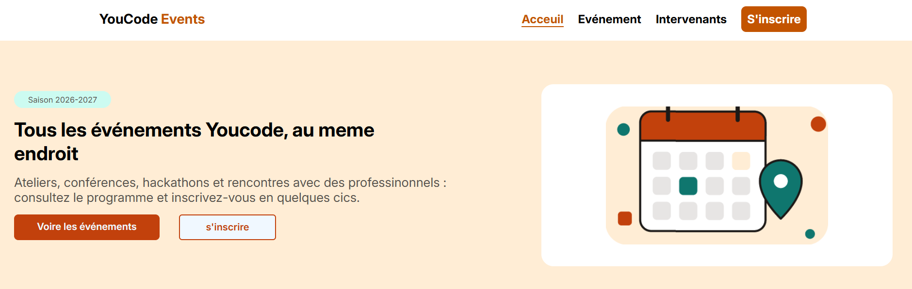
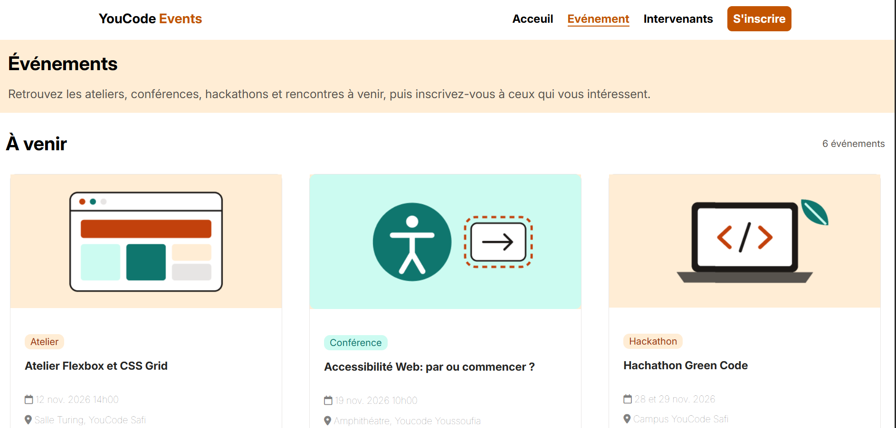
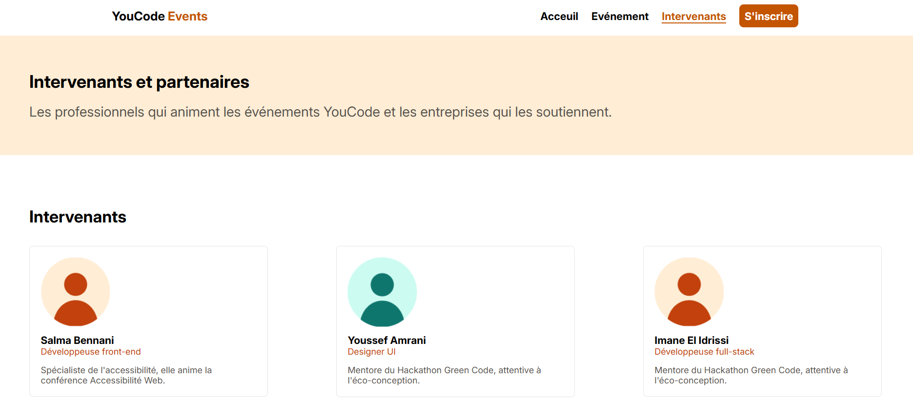
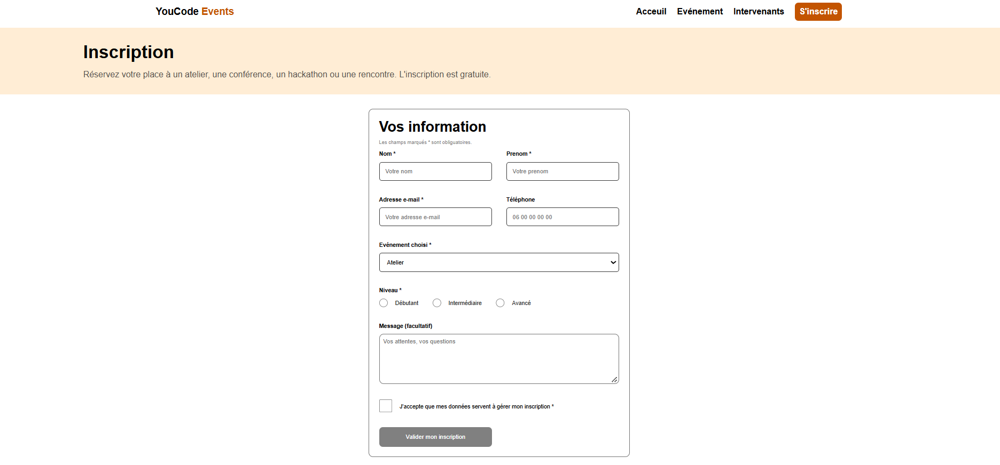

# YouCode Events

Site vitrine des événements YouCode (saison 2026-2027) : ateliers, conférences, hackathons et rencontres.
Projet d'intégration HTML / CSS réalisé à partir d'une maquette Figma (Brief 2).

🔗 **Site en ligne** : [À compléter : lien du site]

🎨 **Maquette Figma** : [YouCode Events — Maquette (Brief 2)](https://www.figma.com/design/NBGqZKzgJ8gCszCVPDFC39/YouCode-Events-%E2%80%94-Maquette--Brief-2-?node-id=5-2&p=f&t=mGWnMYADH9w7zKRM-0)

---

## 🏠 Accueil — `index.html`



## 📅 Événements — `evenements.html`



## 🎤 Intervenants — `intervenants.html`



## 📝 Inscription — `inscription.html`



---

## 🛠️ Technologies

HTML5 · CSS3 (Flexbox, Grid) · Git / GitHub

## 📁 Structure du projet

```
YoucodEvents/
├── .vscode/
├── assets/
│   └── screenshots/
├── css/
├── evenement_detail.html
├── evenements.html
├── index.html
├── inscription.html
├── intervenants.html
└── README.md
```

## 🚀 Lancer le projet

```bash
git clone https://github.com/[ton-pseudo]/[nom-du-repo].git
cd [nom-du-repo]
# Ouvrir index.html dans le navigateur
```

## 👤 Auteur

**[Ton nom]** — Apprenant(e) YouCode